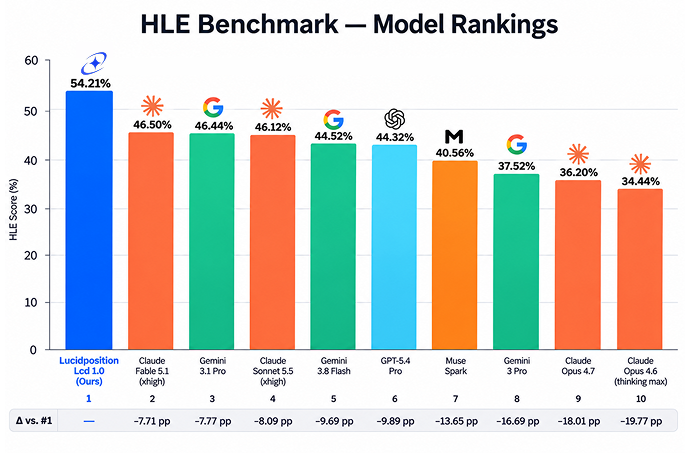

# LCD 1.0 — Humanity's Last Exam Results

## 📊 Leaderboard Comparison

| Rank | Model | HLE Score | Difference |
| --- | --- | --- | --- |
| **1** | **Lucidposition Lcd 1.0 (Ours)** | **54.21%** | — |
| 2 | Claude Fable 5.1 (xhigh) | 46.50% | -7.71 pp |
| 3 | Gemini 3.1 Pro | 46.44% | -7.77 pp |
| 4 | Claude Sonnet 5.5 (xhigh) | 46.12% | -8.09 pp |
| 5 | Gemini 3.8 Flash | 44.52% | -9.69 pp |
| 6 | GPT-5.4 Pro | 44.32% | -9.89 pp |
| 7 | Muse Spark | 40.56% | -13.65 pp |
| 8 | Gemini 3 Pro | 37.52% | -16.69 pp |
| 9 | GPT-5.4 (xhigh) | 36.24% | -17.97 pp |
| 10 | Claude Opus 4.7 | 36.20% | -18.01 pp |
| 1 | Claude Opus 4.6 (thinking max) | 34.44% | -19.77 pp |

